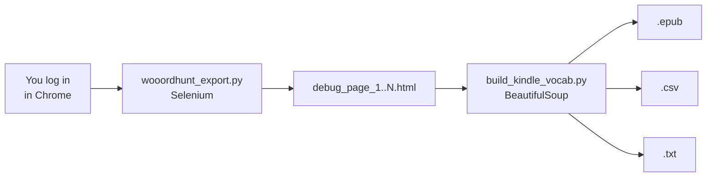

# 📚 WooordHunt Vocabulary Export

Export your personal vocabulary ("Мой словарь") from [wooordhunt.ru](https://wooordhunt.ru) and turn it into clean files you can read on **Kindle** and **KOReader**.


WooordHunt has no export button. This project fills that gap with two small scripts:

1. **`wooordhunt_export.py`**: opens a real browser, lets you log in manually, then walks through every page of your vocabulary and saves the raw HTML of each page.
2. **`build_kindle_vocab.py`**: reads the saved pages, keeps only the word list, and generates an **EPUB** (plus CSV and TXT).

---

## Table of contents

- [How it works](#how-it-works)
- [Requirements](#requirements)
- [Installation](#installation)
- [Usage](#usage)
  - [Step 1: Scrape your vocabulary](#step-1--scrape-your-vocabulary)
  - [Step 2: Build the EPUB / CSV / TXT](#step-2--build-the-epub--csv--txt)
- [Output formats](#output-formats)
- [Reading on Kindle / KOReader](#reading-on-kindle--koreader)
- [Project structure](#project-structure)
- [Troubleshooting](#troubleshooting)
- [Privacy](#privacy)
- [Disclaimer](#disclaimer)

---

## How it works



Your password is never handled by the script. You log in yourself in the browser window that Selenium opens, so there is no credential storage and no need to reverse-engineer the login.

---

## Requirements

- macOS (the steps also work on Linux; adapt the paths on Windows)
- Python 3.9+
- Google Chrome (or Firefox)
- A WooordHunt account with a saved vocabulary

Python packages (see [`requirements.txt`](requirements.txt)):

| Package | Purpose |
|---|---|
| `selenium` | Browser automation (Selenium 4.6+ downloads the matching driver automatically) |
| `beautifulsoup4` | HTML parsing |

---

## Installation

```bash
# 1. Clone the repository
git clone https://github.com/<your-username>/vocabulary_export.git
cd vocabulary_export

# 2. Create and activate a virtual environment
python3 -m venv venv
source venv/bin/activate

# 3. Install dependencies
pip install -r requirements.txt
```

> **Why a virtual environment?** Python installed with Homebrew is "externally managed" (PEP 668), so a plain `pip3 install` fails with `error: externally-managed-environment`. A venv avoids this without touching your system Python.

Every time you open a new Terminal window, re-activate it with `source venv/bin/activate` before running the scripts.

---

## Usage

### Step 1: Scrape your vocabulary

```bash
python wooordhunt_export.py            # Chrome (default)
python wooordhunt_export.py firefox    # Firefox
```

What happens:

1. A browser window opens on the WooordHunt login page.
2. **You** log in and open the **«Мой словарь»** tab (`https://wooordhunt.ru/history/top`). Make sure the **first page** of the list is visible.
3. Return to Terminal and press **Enter**.
4. The script saves each page as `debug_page_N.html` and clicks "next" automatically (», ›, "Далее", …).
5. If no "next" button is detected, it asks you to switch pages manually. Press **Enter** to scrape the new page, or type `q` + **Enter** to finish.

### Step 2: Build the EPUB / CSV / TXT

```bash
python build_kindle_vocab.py                  # alphabetical, A–Z chapters
python build_kindle_vocab.py --order recent   # keep WooordHunt order (newest first)
```

| Option | Default | Description |
|---|---|---|
| `--input-dir` | `.` | Folder containing the `debug_page_*.html` files |
| `--order` | `alpha` | `alpha` = A–Z chapters, `recent` = original order in chunks of 100 |
| `--name` | `wooordhunt_vocabulary` | Base name of the generated files |

Only the actual word rows are kept. The header, search box, menu, "recent history" bar, folders and sort controls are dropped. Duplicate words across pages are removed. Words that have no translation on WooordHunt (for example saved phrases) are still included, as just the word.

---

## Output formats

| File | Content |
|---|---|
| `wooordhunt_vocabulary.epub` | Ebook with a table of contents. Each entry reads **word** *[transcription]* — translation |
| `wooordhunt_vocabulary.csv` | UTF-8 (with BOM) with columns `word`, `transcription`, `translation`; opens in Numbers/Excel and imports into Anki |
| `wooordhunt_vocabulary.txt` | Plain text, one entry per line |

Example entry:

```
excellent [ˈeksələnt] — отличный, превосходный, великолепный
```

> ℹ️ The scraper in Step 1 also writes a `wooordhunt_vocabulary.csv` (with an extra `extra` column). Running Step 2 overwrites it with the cleaned version.

---

## Reading on Kindle / KOReader

- **KOReader device:** connect it over USB and copy the `.epub` into its storage.
- **Kindle (stock firmware):** send the file with [Send to Kindle](https://www.amazon.com/sendtokindle) (EPUB is supported).
- Use the table of contents to jump between letters.

---

## Project structure

```
vocabulary_export/
├── wooordhunt_export.py     # Step 1: Selenium scraper (manual login)
├── build_kindle_vocab.py    # Step 2: HTML → EPUB / CSV / TXT
├── requirements.txt         # Python dependencies
├── .gitignore               # keeps personal data and venv out of Git
└── README.md
```

Generated files (`debug_page_*.html`, `wooordhunt_vocabulary.*`, `vocabulary.txt`, `venv/`) are ignored by Git.

---

## Troubleshooting

| Problem | Fix |
|---|---|
| `error: externally-managed-environment` | Use a virtual environment (see [Installation](#installation)) |
| Chrome does not open / driver error | Update Chrome; make sure you have Selenium ≥ 4.6 (`pip install -U selenium`) |
| `No debug_page_*.html files found` | Run Step 1 first, or pass `--input-dir` |
| 0 words extracted | You were probably not logged in when scraping. Open `debug_page_1.html` and check it shows your list |
| Junk text next to words | WooordHunt may have changed its HTML. Open an issue and paste 2–3 list rows from a `debug_page_N.html` |
| Script stops after the first page | The "next" control was not detected. Use the manual mode prompt and switch pages yourself |

---

## Privacy

- The scripts run **locally**; nothing is sent anywhere except your normal browsing to wooordhunt.ru.
- The saved `debug_page_*.html` files may contain personal data (your word history, possibly account information). They are listed in `.gitignore`. **Do not commit or share them.**
- Your vocabulary exports are also git-ignored by default.

---

## Disclaimer

This is an unofficial personal tool, not affiliated with WooordHunt. It is intended for exporting **your own** data for personal use. Keep the request rate low and respect the site's terms of use.
